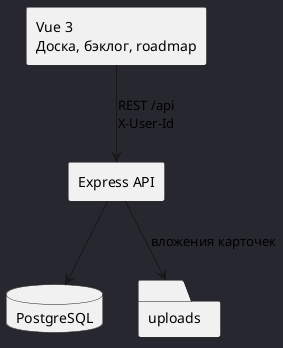
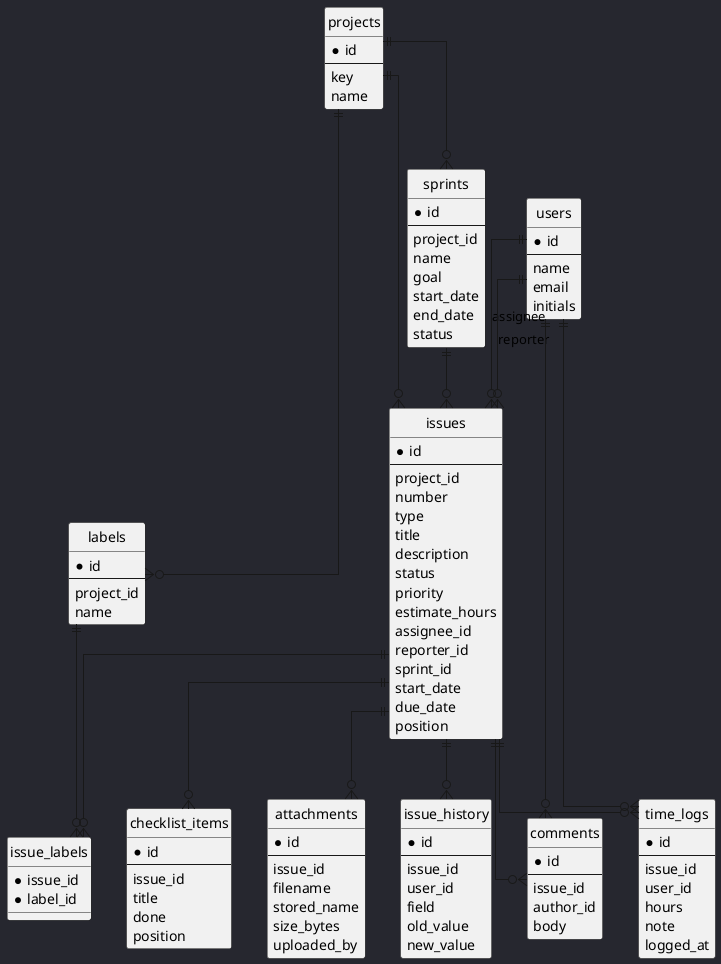
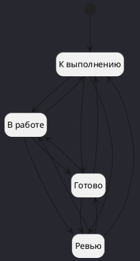
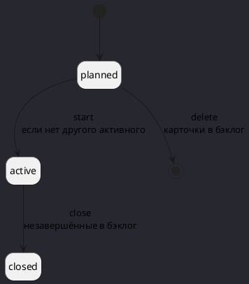
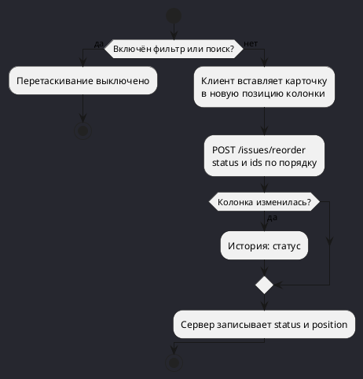

# UML

Диаграммы PlantUML. Вставляются в любой рендер PlantUML как есть.

## Компоненты

## Данные

## Статусы карточки

Переход разрешён между любыми состояниями.

## Статусы спринта

## Перенос карточки по доске

